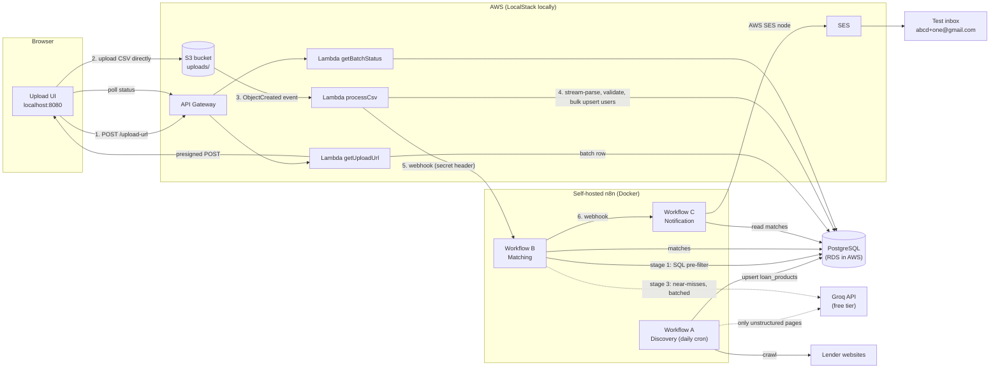

# Loan Eligibility Engine

An automated pipeline that ingests user data (CSV), discovers personal-loan products from lender websites, matches users to the products they are likely eligible for, and emails them.

* **Event-driven ingestion**: browser -> presigned S3 POST -> S3 event -> Lambda -> Postgres
* **All business logic in self-hosted n8n**: 3 workflows (discovery, matching, notification)
* **Optimization Treasure Hunt**: a 4-stage funnel so an LLM only sees a tiny fraction of user-product pairs
* **Runs 100% locally** with Docker Compose: LocalStack (S3, Lambda, API Gateway, SES) + Postgres (stand-in for RDS) + n8n

---

## 1. Architecture



### Pipeline status (visible in the UI)
`awaiting_upload -> processing -> processed -> matching -> matched -> notified`

### Tables
| Table | Purpose |
|---|---|
| `upload_batches` | One row per CSV upload, tracks status + row counts + sample of invalid rows |
| `users` | Parsed CSV rows (`upload_batch_id` identifies "newly added" users) |
| `loan_products` | Crawled products + eligibility criteria |
| `matches` | user x product result with `status` (approved/review/rejected), `stage`, `rank`, `notified` |

---

## 2. Prerequisites
* Docker + Docker Compose v2
* Node.js 18+ and npm (for the Serverless Framework v3)
* Python 3 + pip (the `serverless-python-requirements` plugin runs `pip`)
* AWS CLI (only used to talk to LocalStack, no real AWS account needed for the local demo)
* A free Groq API key (optional but recommended): https://console.groq.com
* A Gmail account + App Password for email notifications (see 3.7)

---

## 3. Setup & Deployment (local)

### 3.1 Configure environment
```bash
cp .env.example .env
```
Edit `.env`: set `GROQ_API_KEY`, `TEST_EMAIL_ALIASES` (replace `abcd` with your Gmail username), `SES_FROM_EMAIL`, `GMAIL_APP_PASSWORD`, and a random `WEBHOOK_SECRET`.

### 3.2 Start the stack
```bash
docker compose up -d
docker compose ps        # postgres must be "healthy"
```
This starts: Postgres (schema auto-created from `sql/init.sql`), LocalStack, n8n (http://localhost:5678), the UI (http://localhost:8080), and mock lender sites (http://localhost:8081/bank-a.html).

### 3.3 Deploy the AWS stack to LocalStack
```bash
npm install
export AWS_ACCESS_KEY_ID=test AWS_SECRET_ACCESS_KEY=test AWS_DEFAULT_REGION=us-east-1
npx serverless deploy --stage local
./scripts/post_deploy.sh        # writes ui/config.js with the API Gateway URL
```
This creates the S3 bucket (with CORS), 3 Lambdas, API Gateway routes, and the S3 -> Lambda trigger.

### 3.4 Configure n8n credentials and import workflows

**Option 1 - scripted**
```bash
cp n8n/credentials.template.json n8n/credentials.json   # edit passwords/keys if you changed them
./scripts/setup_n8n.sh
```

**Option 2 - manual in the n8n UI (http://localhost:5678)**
1. Create the owner account on first launch.
2. *Credentials -> Add credential -> Postgres*, name it **Local Postgres**: host `postgres`, port `5432`, database/user/password from `.env`, SSL `disable`.
3. *Credentials -> Add credential -> AWS*, name it **AWS SES** (see 3.7 for the values).
4. *Workflows -> Import from file* for each of `n8n/workflow-a-discovery.json`, `workflow-b-matching.json`, `workflow-c-notification.json`.
5. Open every Postgres node / the SES node and select the credential if n8n shows it as missing.
6. Toggle each workflow to **Active** (required for production webhook URLs `/webhook/match-users` and `/webhook/notify-users`).

### 3.5 Load loan products (run workflow A once)
Open workflow **A**, click **Run Now (manual)** (the schedule runs it daily at 02:00). Check the result:
```bash
docker compose exec postgres psql -U loan_admin -d loan_engine -c "SELECT source, product_name, interest_rate, min_monthly_income, min_credit_score FROM loan_products;"
```
You should see products from `mock-bank-a` and `mock-bank-b` (structured HTML). `mock-bank-c` is unstructured and only yields products if `GROQ_API_KEY` is set (LLM extraction).

### 3.6 Run the pipeline
1. Open http://localhost:8080, drop `data/users_generated.csv` (or the provided `users.csv`) and click **Upload**.
2. Watch the status steps advance. Check your Gmail inbox.
3. Scalability test: `python3 scripts/generate_sample_users.py 5000 data/users_large.csv` and upload that.

### 3.7 Email delivery (Gmail SMTP)
Workflow C uses a **Gmail SMTP** node (no AWS account needed).

1. Enable 2-Step Verification on your Google account.
2. Go to **Google Account → Security → App Passwords**, create an app password for "Mail".
3. In n8n: *Credentials → Add credential → SMTP*, set host `smtp.gmail.com`, port `465`, SSL `true`, username = your Gmail address, password = the 16-character App Password.
4. Wire this credential into the **Send Email** node in Workflow C.

> The AWS SES node is still present in Workflow C (deactivated) as documentation of the cloud-deployment path.

> Safety: workflow C never emails the addresses in the CSV. Recipients always come from `TEST_EMAIL_ALIASES`, and at most `DEMO_MAX_EMAILS` emails are sent per run.

---

## 4. Design decisions

### 4.1 Ingestion (scalable, event-driven)
A standard "POST the CSV to a Lambda behind API Gateway" design is capped at ~10 MB payload / 29 s. Instead:
1. The UI calls a tiny Lambda that returns a **presigned S3 POST** (with a 50 MB `content-length-range` policy).
2. The browser uploads **directly to S3**. The file never touches Lambda or API Gateway.
3. The **S3 ObjectCreated event** triggers `processCsv`, which **streams** the file line by line, validates each row (email format, score 300-900, age 18-100...), and writes in chunks of 500 rows with one multi-row `INSERT ... ON CONFLICT DO UPDATE`. Memory stays flat regardless of file size and re-uploads are idempotent.
4. S3 events are at-least-once, so the handler skips batches already processed.
5. Invalid rows are counted and a sample is stored in `upload_batches.error_sample`; they do not fail the whole file.
6. On success Lambda calls the n8n webhook (with a shared-secret header and exponential-backoff retries).

### 4.2 Workflow A - discovery (crawler)
* Schedule trigger (daily 02:00) plus a manual trigger for demos.
* **Two-layer extraction.** Layer 1 parses structured `data-*` attributes with a regex (free, deterministic). Only if a page has no structured data does layer 2 send the cleaned page text to the LLM for JSON extraction. This keeps LLM cost at zero for well-structured sites and survives layout changes on others.
* Every product passes a validation/normalisation node (rate 1-60%, score 300-900, canonical employment values) before an idempotent upsert on `(source, product_name)`.
* Products not seen for 3 days are marked inactive (so removed products stop being matched).
* One failing site never stops the others (`continueOnFail` on the HTTP node).
* The three sources are local mock lender sites (`mock-sites/`) so the demo is deterministic. The `Source List` node contains a commented live-site example; real sites may block bots, so treat live crawling as optional.

### 4.3 Workflow B - matching: the Optimization Treasure Hunt
Naive approach: every user x every product -> one LLM call. 5,000 users x 10 products = **50,000 LLM calls**.

My funnel:

| Stage | Where | What it does | Cost |
|---|---|---|---|
| 1. SQL pre-filter | Postgres, one set-based statement | Hard rules for all pairs at once: age range, allowed employment, max score. Income / score are checked with a tolerance band (>= 90% of min income, >= min score - 20). Exact matches are **approved immediately**; near misses are marked `review`. | Milliseconds, no LLM |
| 2. Near-miss fetch | n8n Postgres node | Only `review` pairs are read (capped at 200 per run) | tiny |
| 3. Batched LLM judge | n8n HTTP node -> Groq (qwen/qwen3-8b) | Near misses are packed **35 per call**; the LLM decides if the shortfall is marginal and the profile compensates, and writes a one-line reason that appears in the email. If the LLM is down, near misses are conservatively rejected. | ~1 call per 35 pairs |
| 4. Rank | Postgres | `ROW_NUMBER()` per user (exact matches first, then lowest interest rate); top 3 are emailed | no LLM |

Result: LLM calls scale with *near-miss pairs / 25*, not with *users x products*. The stage-1 node returns `naive_pairs`, `approved_by_sql` and `near_miss_for_llm`, so you can show the reduction in the video (check the node output in the execution view).

Other choices: matching is scoped to the batch (`upload_batch_id`), writes are upserts (re-running a batch is safe), and the webhook is verified with a shared secret.

### 4.4 Workflow C - notification
Triggered by workflow B once ranking is done. One SQL query returns one row per user with their top-3 approved, un-notified products. A Code node builds an HTML email, the **Gmail SMTP node** sends it, then matches are marked `notified` so a re-run never double-sends.

### 4.5 AWS mapping (local vs cloud)
| Local | AWS |
|---|---|
| LocalStack S3 / Lambda / API Gateway | S3 / Lambda / API Gateway (same `serverless.yml`) |
| Postgres container | RDS for PostgreSQL (change `DB_*` env vars; Lambda needs VPC access) |
| SES (LocalStack or sandbox) | SES |
| n8n container | n8n on EC2/ECS (public webhook URL replaces `http://n8n:5678`) |

Not production hardened yet: add VPC + RDS Proxy, Secrets Manager for DB creds, API auth (Cognito/API key), and DLQ for the S3 Lambda.

---

## 5. Demo video script (5-10 min)
1. (0:00) Architecture diagram + `docker compose ps`.
2. (1:00) Workflow A: walk through each node, click *Run Now*, show `loan_products` rows.
3. (3:00) Workflow B: explain the 4 stages, show the SQL pre-filter and the numbers in the node output.
4. (5:00) Workflow C: show the email builder and the SES node.
5. (6:00) Live demo: upload the CSV in the UI, watch the status steps, show the execution list in n8n.
6. (8:30) Show the received email in Gmail. Show `SELECT status, count(*) FROM matches GROUP BY 1;`.

---

## 6. Troubleshooting
| Symptom | Fix |
|---|---|
| UI says upload-url failed | Re-run `./scripts/post_deploy.sh`; check `docker compose logs localstack` |
| S3 upload blocked (CORS) | Redeploy (`serverless deploy --stage local`); check UI is on http://localhost:8080 |
| Batch stuck at `processed` / `webhook_failed` | Workflows not **Active**, or `WEBHOOK_SECRET` differs between `.env` and the deployed Lambda (redeploy after editing `.env`) |
| Lambda cannot reach Postgres | Network name must be `loan-net` (see `docker-compose.yml`) |
| n8n "Credential not found" | Open the node and pick the credential, or import credentials via the script |
| `$env` access denied in n8n | `N8N_BLOCK_ENV_ACCESS_IN_NODE=false` must be set (it is in the compose file) |
| No emails | Check SES verification (sandbox), `TEST_EMAIL_ALIASES`, and the n8n execution log of workflow C |
| `batch matched` but nobody emailed | No user matched any product, or all matches were already notified |

## 7. Project layout
```
docker-compose.yml        Postgres, LocalStack, n8n, UI, mock sites
serverless.yml            S3 + Lambdas + API Gateway (+ S3 trigger)
sql/init.sql              Schema
src/handlers/             get_upload_url, process_csv, get_batch_status
src/common/               db, validation, http helpers
n8n/                      3 workflow JSONs + credentials template
ui/index.html             Upload UI with live progress
mock-sites/               Fake lender pages for the crawler
scripts/                  post_deploy.sh, setup_n8n.sh, generate_sample_users.py
tests/                    Unit tests for validation
```

## 8. Run the unit tests
```bash
pip install pytest boto3 pg8000
pytest -q
```
